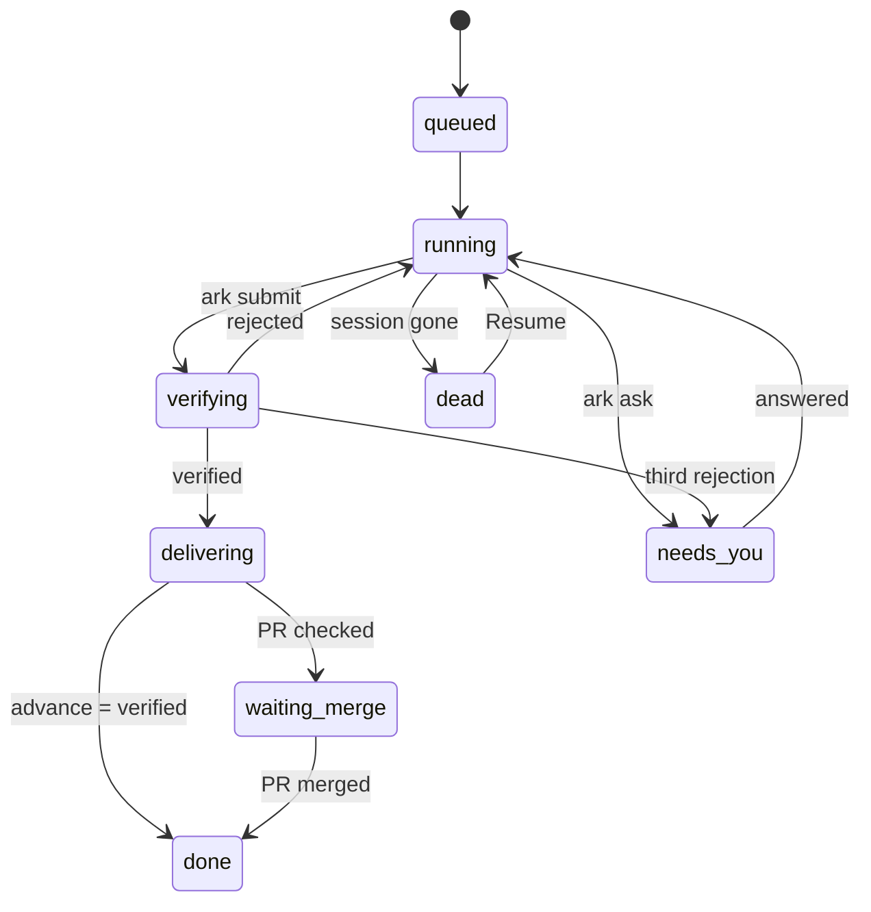

# Arkimedes as a plan queue over Claude Code Workflow

## Problem

The Arkimedes runner does not work well enough: jobs got blocked and asked questions the runner could
not act on, plans were rigid (areas, gates and budgets fixed per job), runs were slow and expensive,
and the runner itself needed constant fixes. Claude Code's Workflow already does the orchestration.
What it lacks is a queue of plans, ordering between them, and one place to follow them.

## Goal

Arkimedes becomes a thin layer over Workflow: Marco approves light plans, places them in lanes, and
each plan runs in its own visible Claude Code session, where Claude writes and runs the workflow.
A web page shows lanes, progress, questions and cost.

It works when:

- two lanes run in parallel and the plans inside each lane run in order, with no terminal action;
- no plan counts as done without a commit, a green gate and an independent review;
- Marco answers a plan's questions from the page and the same session finishes what was left.

## Decisions

- **One interactive session per plan, in tmux**
  - Alternatives: headless `claude -p` or the Agent SDK; one long dispatcher session.
  - Pros: Marco can attach, watch `/workflows` and talk to it; interactive sessions can wait out usage limits.
  - Cons: harder to drive from a program than a headless run.
  - Why: headless and background runs fail at the usage limit instead of waiting.

- **Claude writes the workflow script for each plan; only the plan is approved**
  - Alternatives: fixed saved workflows that take the plan as arguments; approve plan and script.
  - Pros: the session adapts without re-approval.
  - Cons: runs are less predictable, and no rule can rely on what a script does.
  - Why: rigid plans were one of the four failures.

- **Ark verifies "done" itself, outside the session**
  - Alternatives: rules in the prompt; a Stop hook that blocks the session.
  - Pros: holds whatever the script does.
  - Cons: Ark runs the gate and one reviewer call per delivery, even if the workflow already did both.
  - Why: a prompt guarantees nothing, and Claude Code overrides a Stop hook after repeated blocks.

- **The independent review is a separate read-only `claude -p` started by Ark**
  - Alternatives: trust a review agent inside the workflow; no review beyond the gate.
  - Pros: independent by construction; its verdict is tied to a commit.
  - Cons: extra cost; being headless, it fails at the usage limit and must be run again.
  - Why: Ark cannot prove that a review inside the workflow happened or was independent.

- **Sessions pull messages from Ark with a blocking background command**
  - Alternatives: type into the pane with `tmux send-keys`; cross-session messaging; restart with `claude --resume`.
  - Pros: no injected keystrokes; a finished background command wakes the session.
  - Cons: it depends on the session starting the wait. Check C3 passed after 4 h 10 min; a wait that spans Mac sleep is untested.
  - Why: no documented way to send input from a script was found.

- **One local process, `ark serve`, with no model**
  - Alternatives: a separate daemon and UI server; a hosted service.
  - Pros: one thing to start; it dispatches, verifies, serves the page and receives telemetry.
  - Cons: while it is down nothing advances and telemetry is lost.
  - Why: single user, single machine.

- **A new small core in this repo; the runner and Euklides are deleted**
  - Alternatives: a new repo; replace only the engine inside the runner; keep both for a while.
  - Pros: the page, approval flow and plan reading are reused; no second system to maintain.
  - Cons: deleting is costly to undo, and there is no fallback runner.
  - Why: the runner does not work, and git history keeps it.

- **Build a thin layer instead of adopting a product**
  - Alternatives: Claude Code Desktop (parallel sessions and workflow progress, but no lanes or enforced local gates); Ivy Tendril (plan lifecycle and gates, but lanes and Workflow support unconfirmed); Agent Orchestrator (worktrees, board and reviewer, but no ordered queue or plan approval).
  - Pros: covers exactly the lanes and rules wanted.
  - Cons: our own code to maintain. The comparison came from docs and READMEs; none was tried.
  - Why: no product found covers lanes, Workflow sessions, end-of-run questions and enforced verification together.

## Design

### Parts

| Part | Does | Does not |
|---|---|---|
| `/ark-plan` | writes a light plan from any session | run or approve it |
| `ark serve` | dispatches lanes, starts sessions, verifies, serves the page, collects usage | call a model, except to start the reviewer; retry, merge or unblock by itself |
| plan session | writes and runs the workflow, commits, asks, opens PRs | decide that it is done |
| reviewer | judges one commit range against the plan | edit anything |

### Plan format

Sections: `## Goal`, `## Context`, `## Decisions` (may say `None.`), `## Tasks` (free prose, one
heading per task) and `## Run`, a YAML block:

```yaml
setup: [pnpm install]        # what a fresh worktree needs
gate: pnpm test              # required; must pass on every delivered commit
tasks:
  - { id: T1, title: "notes.delete handler", after: [], done: ["delete removes the file"] }
delivery:
  prs: single                # single | per_group (tasks then carry `group:`)
  merge: manual              # manual | auto
  advance: merged            # merged | verified
```

There are no areas, per-job budgets or model tiers. Validation checks only: required sections, a
gate, unique task ids, an acyclic `after`, at least one `done` item per task, and the delivery
values. With `advance: verified`, the next plan of the lane in the same repo starts from the
previous plan's last verified branch (stacked); otherwise it starts from the updated default branch.

Approval works as today: Marco only, from the terminal or a click on the page, tied to the file's
hash. Ark freezes a copy, and every later step reads that copy, never a file in the worktree.

### Lanes

A lane is an ordered list of approved plans. Lanes run in parallel, up to `max_sessions`
(default 3). The head of a lane starts when a slot is free. A lane moves on only when its head
reaches the point its `advance` names. A head that needs Marco, is dead or was stopped holds its
lane; other lanes continue. Marco can reorder or move any plan that has not started, and remove a
stopped one. There is no overlap check between lanes.

### Plan states



`stopped` can be reached from any state before `done`, only by Marco. A stacked plan with
`advance: verified` still shows each PR as open until it is merged.

### Starting a session

`tmux` must be installed. Ark creates `<repo>/.claude/worktrees/ark-<slug>` on branch `ark/<slug>`, runs `setup`, and opens a
tmux session that runs `claude` with a known `--session-id`, `--effort ultracode`,
`--permission-mode auto`, Ark's per-plan `--settings` file, and a first prompt that holds the frozen
plan and the protocol below. The repo must already be trusted; if it is not, the plan goes to
`needs_you` with that reason. `ultracode` raises effort and cost; it is there so the workflow starts
without an approval prompt (check C1). C1 passed only with `skipWorkflowUsageWarning` already on in
the user settings, so Ark checks it and warns if it is missing. The worktree and branch are removed
once the PRs are merged, never while work is unmerged without Marco's OK.

The user's settings and hooks apply to plan sessions and to the reviewer. Ark sets `ARKIMEDES=1`
in their environment, which turns the coach hooks off; everything else stays on.

### Session protocol

The session talks to Ark only through these commands. It never writes Ark's state files.

| Command | When |
|---|---|
| `ark event <task> start\|done\|failed [--note]` | by workflow agents, for progress. Scripts have no shell, so their agents run it |
| `ark submit` | the work is committed and ready; Ark records the head of each delivery branch |
| `ark ask` | one or more questions, after finishing everything that does not depend on them |
| `ark wait` | right after `submit` or `ask`, as a background command; exits with Ark's next message |
| `ark delivered --pr <url>` | after pushing and opening each PR |

`ark event` and the other commands write to disk directly, so they work while `ark serve` is down.
Progress is what the agents report: it is informative and no rule depends on it. The page marks a
task as unreported instead of guessing. `done` only means that an agent finished running: in check
C4 a blocked agent reported it too. The page never shows a task as complete on that event alone;
tasks are complete only when Ark has verified the delivery that holds them.

### Verification and delivery

On `submit`, for each delivery branch, Ark checks in order:

1. the tree is clean and the head has commits over its base;
2. `setup` and `gate` pass in a fresh checkout of that head;
3. the reviewer, given the frozen plan and the diff from base to head, returns `pass` with every
   `done` item marked met, or `fail` with findings.

All pass: Ark records the verified commit and tells the session to deliver. Any failure: the message
carries the gate output or the findings, and the session fixes it. After the second rejection, the
third one goes to Marco as a question. A reviewer that gives no verdict (usage limit, network) is
not a rejection: the plan stays in `verifying` and Ark runs it again later.

On `delivered`, Ark checks with `gh` that the PR's head is the verified commit. If a PR gains
commits later, it is no longer verified and needs a new `submit`; the page says so. With
`merge: auto`, the session merges after that check. With `merge: manual`, Marco merges. A lane never
advances on a PR whose merged head was not verified.

### Questions

A workflow cannot ask mid-run, so it finishes what it can and returns what it needs. The session
then calls `ask`. The plan shows `needs_you`, Marco gets a notification and answers on the page or
with `ark answer`; `ark wait` returns the answer and the session relaunches only what is left. Marco
can instead attach to the tmux session and talk to it.

### Failures

| Case | What happens |
|---|---|
| usage limit | the interactive session waits and continues, with auto-continue on; the page shows how long it has been quiet |
| session gone | `dead`; the page offers Resume (`claude --resume` in a new tmux session). No automatic restart |
| quiet too long | a flag and a notification, no action |
| `ark serve` restarted | state is rebuilt from disk; live tmux sessions are matched by name |
| merge conflict on delivery | the session resolves it and submits again |

### Usage and cost

Each session and reviewer is started with OpenTelemetry on, sending to a receiver inside
`ark serve` on `127.0.0.1`. Tokens and cost are grouped by plan through the session id; workflow
events also carry the workflow run id. USD is the API-equivalent figure. There are no spending caps.

### State on disk

| Path (under `~/.claude/arkimedes/`) | Holds |
|---|---|
| `desk/<repo>/<slug>/` | plan, optional spec, review (as today) |
| `approvals/` | approvals; only `ark approve` and the page write it |
| `state/lanes.json` | lanes and their order |
| `state/plans/<repo>/<slug>/` | state, events, messages, verifications, usage, gate logs |

### The page

It keeps today's rules: local only, a session token on every write, one vanilla file, dark only,
the constellation as the way to show work.

| Screen | Shows |
|---|---|
| Lanes (home) | what needs Marco first, then each lane with its plans in order; drag to reorder or move |
| Draft | plan review by section and approval, then "add to lane" |
| Plan | tasks as a constellation with reported progress, verification results, questions with an answer box, events, how to attach, Resume and Stop |
| Dashboard | time, tokens and cost per plan, lane, repo and period; verification rejections |

### Safety

Runner-side processes cannot approve or answer, and the desk guard stays. Sessions run in auto mode
with a per-plan settings file that denies writing `state/` and `approvals/`. The reviewer gets read
tools only. These guard against mistakes, not against a hostile agent: sessions run as Marco's user.
The gate runs code from the plan's branch on this machine, as today.

### What is reused and removed

- **Reused:** the page and its server, section reviews, draft listing, approval, plan reading,
  notifications, the spec-review renderer, and the parts of the git and GitHub helpers that fit.
- **Removed:** `ark-loop`, dispatch, integrate, refresh and merge commands; Euklides; estimates,
  budgets and caps; areas and their guards; the worker agents, their hooks and settings; the tests
  and docs of all of these.
- **Kept in place at cutover:** `hooks/desk-guard.py` (the user settings point at its path),
  `~/.local/bin/ark` and the `ark-plan` skill link. `~/.local/bin/ark-loop` and
  `~/.claude/agents/arkimedes.md` are removed or updated.
- **Old data:** `history/`, `runs/` and old plans stay on disk and are not imported. An old draft is
  rewritten in the new format when Marco picks it up.

## Build plan

This is built with a Workflow. That workflow follows the same rules: each package ends with a
commit, a green suite and a review by another agent. It starts only after the checks have a result.

### Checks first

All six passed on 2026-11-27, run by Claude on a throwaway repo; no fallback was needed. Steps,
stand-in scripts, pass criteria and results: `workflow-wrapper-checks/README.md`.

| Check | Question | If it fails |
|---|---|---|
| C1 | Does a session started from a program launch an ad-hoc workflow with no keypress? | try a permission rule or hook; else one manual confirmation per plan |
| C2 | Do workflow agents reliably run `ark event`? | show progress per phase from telemetry, or none in v1 |
| C3 | Does a background `ark wait` wake the session, also after hours? | `tmux send-keys`; else `claude --resume` with the message |
| C4 | After an answer, does the session redo only what was left? | accept the repeat cost, or ask it to skip tasks already committed |
| C5 | Does telemetry give per-plan tokens and cost, workflow agents included? | show what the status line or transcript gives; else drop cost from v1 |
| C6 | Do auto mode and the settings file let a session commit, push and open a PR unattended? | allow those commands in the settings file |

C1, C3 and C6 shape the core: if one fails with no working fallback, the build does not start and
the design is revisited.

### Packages

| Id | Delivers | After | Done when |
|---|---|---|---|
| W1 | plan format, validation, approval with frozen copy, new template | checks | valid and invalid plans are covered by tests |
| W2 | state store, lanes and plan state machine, the `ark` session commands | W1 | every transition and lane rule has a test, restart included |
| W3 | verification: fresh checkout, gate, reviewer, delivery check | W2 | a red gate, a failing review, a dirty tree and a changed PR head are each rejected |
| W4 | session launcher, dispatcher, resume, quiet and dead detection, notifications | W2 | a fake `claude` runs two lanes end to end |
| W5 | telemetry receiver and usage store | W2 | sample payloads give the right totals per plan |
| W6 | page: lanes, draft, plan, questions | W2 | API and screen tests pass; every action works from the keyboard |
| W7 | page: dashboard | W5, W6 | its numbers match a fixture |
| W8 | `/ark-plan` rewritten for the light format | W1 | its example plan validates |
| W9 | removal of the old runner, docs, cutover steps | W3, W4, W6, W7, W8 | the suite is green; nothing imports removed code |

W3, W4, W5 and W8 can run in parallel; so can W6 next to them. New code lives apart from the runner's
modules until W9, so packages do not edit files that are about to be deleted. Delivery: one PR for
W1–W8 and one for W9, both merged by Marco.

## Testing

The state machine, lanes, validation and verification are tested without a model. A fake `claude`
and a fake `gh` cover the whole flow. One real run on a throwaway repo, with two lanes and one
planted question, closes the build. When Marco tries the product, one question is left unanswered
while the Mac sleeps, to cover the case C3 did not.

## Out of scope

Spending caps; retries or unblocking by Ark; overlap detection between lanes; a limit of one gate
at a time; a planning chat in the page; importing old history; other model providers; running in
the cloud or for several users.

## Open questions

None.
